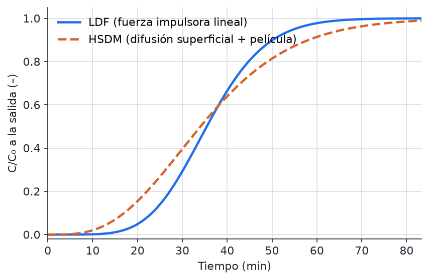
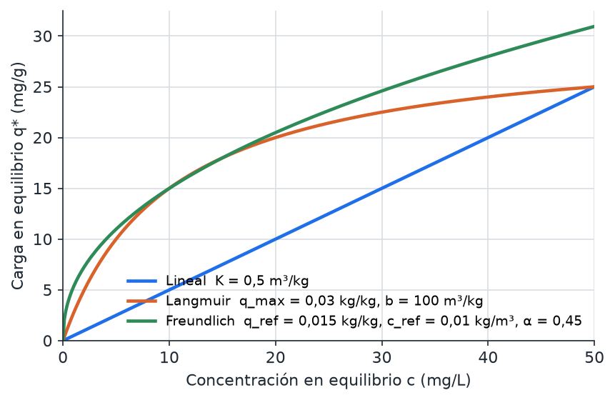
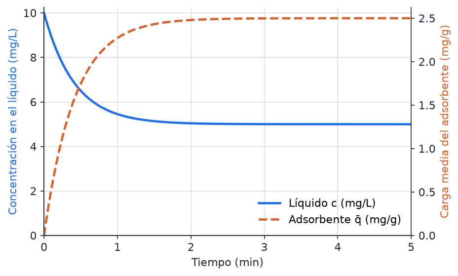
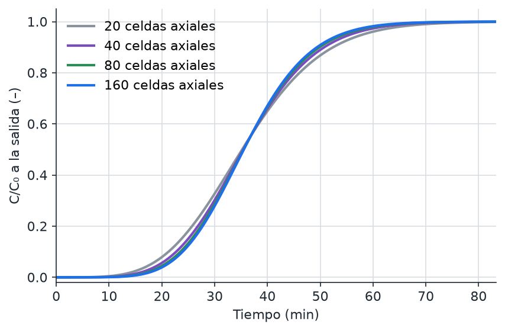
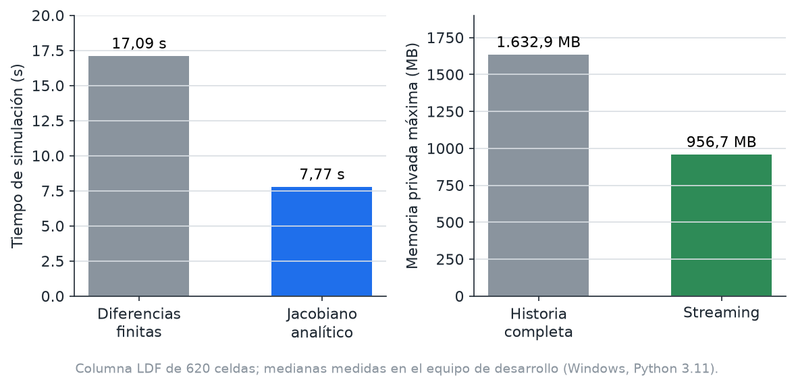

# SorbFlow

[](https://github.com/karelsanchez/SorbFlow/actions/workflows/ci.yml)
[](https://sorbflow.readthedocs.io)
[](https://pypi.org/project/sorbflow/)
[](https://pypi.org/project/sorbflow/)
[](https://www.apache.org/licenses/LICENSE-2.0)

**SorbFlow** es una herramienta en Python para **modelar, simular, calibrar y diseñar
procesos de adsorción en fase acuosa**, en reactores batch y en columnas de lecho fijo.
Reúne en una sola biblioteca isotermas de equilibrio, modelos cinéticos LDF y HSDM,
integración numérica rígida con control de balance de masa, calibración de
parámetros, propagación de incertidumbre, diseño hidráulico y optimización
multiobjetivo, con unidades SI explícitas y resultados trazables por huella SHA-256.

Se usa desde **Python**, desde la **línea de comandos** (`sorbflow`) o desde una
**interfaz web local**; las tres vías ejecutan los mismos motores de cálculo.
Antes se llamaba PyFAST.



## Características principales

- **Cualquier soluto y adsorbente.** Contaminantes, materiales y recetas son datos de
  configuración, no código: sirve para colorantes, metales, compuestos orgánicos u
  otros solutos con sus parámetros. Las mezclas de N adsorbentes se describen con
  fracciones de masa seca (`AdsorbentBlend`).
- **Modelos intercambiables.** Isotermas lineal, Langmuir y Freundlich; cinética LDF
  o HSDM con película; dispersión axial y fronteras de Danckwerts. Cambiar de modelo
  es cambiar una línea del archivo de configuración.
- **Unidades seguras.** Entradas con unidades (mg/L, min, cm, g…) convertidas a SI de
  forma explícita; base seca y velocidades superficial e intersticial diferenciadas.
- **Control numérico completo.** Celdas axiales y radiales, integradores BDF o Radau,
  tolerancias por tipo de estado, Jacobiano analítico y modo streaming.
- **Resultados verificables.** Cada simulación comprueba el balance global de masa y
  la positividad, y guarda configuración, versiones, revisión del código y huellas.
- **Del laboratorio al diseño.** Importación de curvas de ruptura con unidades,
  ajuste de isotermas y constantes cinéticas, Monte Carlo, EBCT, Ergun, costo de
  operación, DXF del lecho y optimización NSGA-II con restricciones.

## Motores de cálculo

| Motor | Qué resuelve | Punto de entrada |
|---|---|---|
| Batch LDF | Recipiente cerrado: concentración y carga hasta el equilibrio | `sorbflow.simulate.batch` |
| Columna LDF | Lecho fijo con volúmenes finitos axiales, dispersión y Danckwerts | `sorbflow.simulate.column` (`kind: "ldf"`) |
| Columna HSDM | Lecho fijo con difusión radial en la partícula y resistencia de película | `sorbflow.simulate.column` (`kind: "hsdm"`) |
| Integración rígida | BDF/Radau (SciPy), Jacobiano disperso analítico opcional, historia en streaming | `sorbflow.solvers.SolverOptions` |
| Calibración | Ajuste de isotermas y `k_LDF`, SVD, perfiles de verosimilitud, objetivos multiensayo | `sorbflow.fit`, `sorbflow.calibration` |
| Incertidumbre | Monte Carlo reproducible y sensibilidad local | `sorbflow.uncertainty` |
| Optimización | NSGA-II multiobjetivo con restricciones y reevaluación | `sorbflow.optimize.nsga2` |
| Diseño | EBCT, residencia, Ergun, potencia, costo y DXF | `sorbflow.design` |
| Entrada/salida | CSV con unidades, JSON, CSV y Parquet con huellas | `sorbflow.io` |
| Interfaz local | Servidor seguro en `127.0.0.1` sobre los mismos motores | `python -m sorbflow.web` |

Arquitectura y detalle de cada motor en [motores de cálculo](docs/engines.md).

## Ecuaciones

Isotermas:

$$
q^* = K c, \qquad q^* = \frac{q_{max}\, b\, c}{1 + b\, c}, \qquad q^* = q_{ref}\left(\frac{c}{c_{ref}}\right)^{\alpha}
$$

Cinética LDF y difusión superficial homogénea (HSDM) con película:

$$
\frac{d\bar q}{dt} = k_{LDF}\,\big[q^*(c) - \bar q\big],
\qquad
\frac{\partial q}{\partial t} = \frac{D_s}{r^2}\frac{\partial}{\partial r}\left(r^2 \frac{\partial q}{\partial r}\right),
\qquad
\rho_p D_s \left.\frac{\partial q}{\partial r}\right|_{R} = k_f (c - c_s)
$$

Columna de lecho fijo con fronteras de Danckwerts:

$$
\varepsilon \frac{\partial c}{\partial t} + u \frac{\partial c}{\partial z}
= \varepsilon D_{ax} \frac{\partial^2 c}{\partial z^2} - \rho_b \frac{\partial \bar q}{\partial t},
\qquad
u\,c - \varepsilon D_{ax}\frac{\partial c}{\partial z}\Big|_{0} = u\,c_{in},
\qquad
\frac{\partial c}{\partial z}\Big|_{L} = 0
$$

Batch: $V_l\, dc/dt = -m_s\, d\bar q/dt$. Diseño: $\mathrm{EBCT}=V_b/Q$ y pérdida de
carga de Ergun. Símbolos, unidades, condiciones y discretización en
[modelos y ecuaciones](docs/models.md).

## Figuras

| | |
|---|---|
|  |  |
| Isotermas lineal, Langmuir y Freundlich | Cinética batch LDF hasta el equilibrio |
|  |  |
| Convergencia al refinar la malla axial | Jacobiano analítico y modo streaming |

Todas se regeneran con `python scripts/make_figures.py` a partir de simulaciones
reales de los ejemplos incluidos. Ver la [galería](docs/figures.md).

## Inicio rápido

Instalación (Python 3.11 o superior):

```bash
pip install sorbflow                       # núcleo: Pint, NumPy, SciPy
pip install "sorbflow[optimize,parquet]"   # NSGA-II y exportación Parquet
```

Línea de comandos, con los ejemplos de `examples/`:

```bash
sorbflow batch  examples/batch_ldf.json   --output runs/batch
sorbflow column examples/column_ldf.json  --output runs/columna_ldf --cells 100
sorbflow column examples/column_hsdm.json --output runs/columna_hsdm --cells 40 --radial-cells 12
```

Python:

```python
from pathlib import Path
from sorbflow import SimulationConfig
from sorbflow.simulate import column
from sorbflow.solvers import SolverOptions
from sorbflow.io import export_result

config = SimulationConfig.from_json(Path("examples/column_ldf.json").read_text())
result = column(config, options=SolverOptions(axial_cells=200, jacobian="analytic"))
print(result.outlet_concentration_kg_m3[-1])
export_result(result, Path("runs/mi_columna"))   # result.json, timeseries.csv, huellas
```

Interfaz web local:

```bash
python -m sorbflow.web --output runs/gui        # abre http://127.0.0.1:8765
```

Cada ejecución crea una carpeta nueva y nunca sobrescribe resultados anteriores.

## Rendimiento medido

| Capacidad | Resultado |
|---|---|
| Jacobiano analítico (columna LDF, 620 celdas) | 7,77 s frente a 17,09 s: **2,2 veces más rápido** |
| Modo streaming | 956,7 MB frente a 1.632,9 MB de memoria privada, con la misma curva de salida |
| Alta resolución | 7.440 celdas y 4.767 instantes de salida en ≤262,4 s |

Mediciones en el equipo de desarrollo (Windows, Python 3.11); detalle en
[rendimiento](docs/performance.md).

## Verificación y calidad

- **588 pruebas automatizadas** con cobertura del 95 %; integración continua en
  Windows y Linux con Python 3.11, 3.12 y 3.13, y documentación en modo estricto.
- **Verificación numérica (E01)**: 219 criterios en 40 integraciones frente a
  soluciones analíticas, 138 criterios frente a una solución continua de
  advección–dispersión y un suplemento de 29 casos y 148 criterios; todos aprobados,
  con protocolos fijados antes de ejecutar.
- **Inferencia (E02)**: 3.000 conjuntos sintéticos y 6.000 perfiles de verosimilitud.
- **Diseño robusto (E03)**: 0 incumplimientos en 40 escenarios independientes para
  los diseños robustos, frente a 6 y 13 de los deterministas.
- **Caso de columna (E04)**: calibración con datos publicados y convergencia local.

Resultados y protocolos en [benchmarks ejecutados](docs/benchmark_results.md) y
[estado de los estudios](docs/scientific_status.md).

## Comparación con otras herramientas

| Herramienta | Licencia | Lecho fijo | Batch | LDF | Difusión intrapartícula | Multicomponente | Calibración / UQ | Optimización | API Python |
|---|---|---|---|---|---|---|---|---|---|
| **SorbFlow** | Apache-2.0 | Sí | Sí | Sí | HSDM | Hoja de ruta | Sí | NSGA-II | Sí |
| FAST 2.1 | CC BY-NC-ND 3.0 | Sí | n. d. | Sí | HSDM | n. d. | n. d. | n. d. | n. d. |
| Aspen Adsorption | Propietaria | Sí | n. d. | Sí | Sí | Sí | n. d. | Sí | n. d. |
| CADET | GPL-3.0 | Sí (cromatografía) | n. d. | n. d. | Sí | Sí | Sí | Sí | Sí |
| pysorb | MIT | Sí | n. d. | n. d. | Crank | Sí | Ajuste | n. d. | Sí |

Comparación por funciones documentadas en las fuentes oficiales de cada herramienta
("n. d.": no documentado en la fuente consultada). Tabla completa, AdDesignS,
RUPTURA, pyGAPS y fuentes en [comparación](docs/comparison.md).

## Documentación

Documentación completa: **<https://sorbflow.readthedocs.io>** (también se construye
localmente con `python scripts/build_docs.py`).

- [Qué es SorbFlow](docs/capabilities.md) · [Primeros pasos](docs/getting_started.md) ·
  [Tutoriales](docs/tutorials.md) · [Galería de ejemplos](docs/examples_gallery.md)
- [Modelos y ecuaciones](docs/models.md) · [Motores de cálculo](docs/engines.md) ·
  [Configuraciones](docs/configurations.md) · [Referencia de API](API_REFERENCE.md)
- [Interfaz web](docs/web_interface.md) · [Preguntas frecuentes](docs/faq.md)

## Hoja de ruta

Sistemas multicomponente, efectos térmicos, alimentación variable en el tiempo,
incertidumbre con discrepancia de modelo, exportación CAD/STEP y adaptadores de
interoperabilidad. Etapas y criterios en [DEVELOPMENT_ROADMAP.md](DEVELOPMENT_ROADMAP.md).

## Autores y cita

- **K. A. Sanchez Hernandez** (Karel Aldrin Sanchez Hernandez) — Universidad de
  Cundinamarca, Ingeniería Ambiental. Responsable del proyecto y desarrollo.
- **D. E. Rodriguez Saiz** (David Esteban Rodriguez Saiz) — pruebas del software.
- **D. X. Cabrera Obando** (Dayana Ximena Cabrera Obando) — pruebas del software.
- **G. J. Romo Cadena** (Gabriela Johana Romo Cadena) — validación técnica de los
  fenómenos químicos.

Para citar SorbFlow use `CITATION.cff` o la página [cómo citar](docs/citation.md).

## Licencia

SorbFlow se distribuye bajo la licencia Apache-2.0 (archivo `LICENSE`). Es un
desarrollo independiente: no incluye código, ejecutables ni recursos de otros
programas de adsorción. El complemento `[optimize]` usa pymoo (Apache-2.0), que
depende de moocore (LGPL-2.1-or-later).
