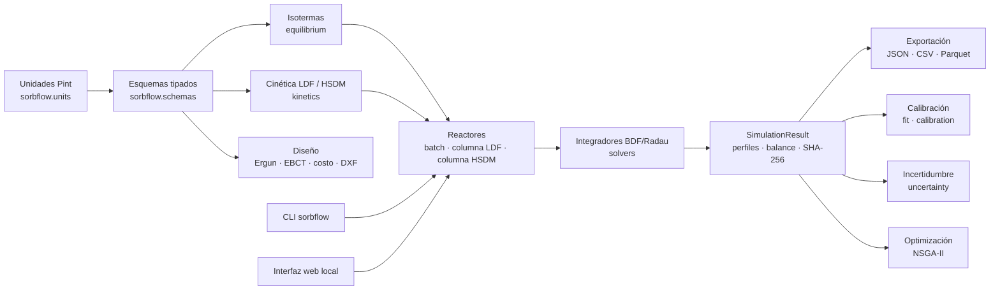
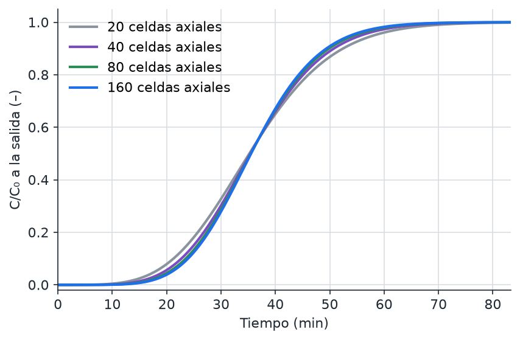

# Motores de cálculo y funciones

[Inicio](index.md) · [Modelos y ecuaciones](models.md) · [Referencia de API](../API_REFERENCE.md)

SorbFlow se organiza en motores independientes que comparten los mismos esquemas de
datos, unidades SI y formato de resultados. La API de Python, el comando `sorbflow`
y la interfaz web local llaman exactamente a los mismos motores.

## 1. Motor batch LDF

| Aspecto | Detalle |
|---|---|
| Resuelve | Concentración en el líquido y carga media en un recipiente cerrado |
| Función | `sorbflow.simulate.batch(config, time_s=None, options=None, code_revision=...)` |
| Entrada | `BatchConfig` (volumen, masa seca, isoterma, constante LDF, condiciones iniciales) |
| Numérica | Dos estados acoplados, integración rígida, balance $V_l c + m_s \bar q$ verificado |
| Uso típico | Cinéticas de laboratorio, ajuste de `k_LDF`, comprobación rápida de parámetros |

## 2. Motor de columna LDF (volúmenes finitos axiales)

| Aspecto | Detalle |
|---|---|
| Resuelve | Curva de ruptura y perfiles $c(z,t)$, $\bar q(z,t)$ en un lecho fijo |
| Función | `sorbflow.simulate.column(config, time_s=None, options=None, ...)` con `kinetics.kind = "ldf"` |
| Numérica | Volúmenes finitos conservativos, upwind + dispersión centrada, Danckwerts, masas de entrada/salida integradas como estados |
| Opciones | `axial_cells`, `method` (BDF/Radau), tolerancias, `jacobian="analytic"`, `history="streaming"` |
| Uso típico | Diseño y comparación de columnas, estudios de malla, calibración con curvas de ruptura |

**Jacobiano analítico disperso.** Para LDF con isoterma lineal o Langmuir, el motor
construye el Jacobiano exacto en lugar de aproximarlo por diferencias finitas: en una
columna de 620 celdas redujo la mediana de 17,09 s a 7,77 s (2,2 veces más rápido).

**Historia en streaming.** En lugar de guardar todos los estados internos del
integrador, conserva solo los instantes pedidos y los controles de balance: misma
curva de salida con 956,7 MB de memoria privada frente a 1.632,9 MB.

## 3. Motor de columna HSDM (película + difusión radial)

| Aspecto | Detalle |
|---|---|
| Resuelve | Columna con difusión superficial dentro de cada partícula y resistencia de película |
| Función | `sorbflow.simulate.column(...)` con `kinetics.kind = "hsdm"` |
| Numérica | Volúmenes finitos esféricos con pesos exactos de cascarón en cada celda axial; acoplamiento conservativo por el flujo de película |
| Opciones | `axial_cells`, `radial_cells`, integrador y tolerancias |
| Salidas extra | `radial_loading_kg_kg` (tiempo × celda axial × celda radial) y `r_m` |
| Uso típico | Sistemas con control por difusión interna; comparación con la aproximación LDF |

## 4. Integradores y control numérico

`sorbflow.solvers.SolverOptions` reúne la configuración numérica:

| Campo | Defecto | Función |
|---|---|---|
| `method` | `"BDF"` | Integrador rígido `BDF` o `Radau` (SciPy) |
| `rtol` | `1e-7` | Tolerancia relativa |
| `atol_concentration_kg_m3`, `atol_loading_kg_kg`, `atol_mass_kg` | `1e-10`, `1e-12`, `1e-12` | Tolerancias absolutas por tipo de estado |
| `mass_rtol`, `mass_reference_kg` | `1e-6`, `1e-12` | Criterio del balance global de masa |
| `max_step_s` | `None` | Paso máximo opcional |
| `axial_cells`, `radial_cells` | `100`, `20` | Resolución espacial |
| `jacobian` | `"finite_difference"` | `"analytic"` para columnas LDF compatibles |
| `history` | `"dense"` | `"streaming"` para reducir memoria |

Si el integrador falla, aparece un estado no finito, la negatividad supera diez veces
la tolerancia o el balance no cierra, se lanza `SimulationError` (o `PhysicsViolation`)
y no se entrega un resultado corregido.

## 5. Motor de calibración

| Función | Qué hace |
|---|---|
| `sorbflow.fit.isotherm(c, q, initial, std_loading_kg_kg=None)` | Ajusta parámetros de isoterma en coordenadas logarítmicas |
| `sorbflow.fit.batch_rate(config, observations)` | Estima `k_LDF` a partir de una cinética batch |
| `sorbflow.calibration.profile.profile_gaussian_known_sigma(...)` | Perfiles de verosimilitud con multiinicio y presupuesto de evaluaciones |
| `sorbflow.calibration.batch_objective.LinearBatchObjective` | Objetivo compartido para varios ensayos batch |

Cada ajuste entrega parámetros, residuos, descomposición SVD, número de condición y
covarianza local; un optimizador que no converge produce `FitError`.

## 6. Motor de incertidumbre y sensibilidad

- `sorbflow.uncertainty.monte_carlo(evaluate, sampler, n_samples, seed, model_id, probabilities)`:
  propagación con generador local reproducible; guarda muestras, media, desviación,
  error estándar y cuantiles.
- `sorbflow.uncertainty.local_sensitivity(evaluate, point_si, steps_si)`: Jacobiano por
  diferencias centrales con pasos explícitos por parámetro.

## 7. Motor de optimización multiobjetivo

`sorbflow.optimize.nsga2(evaluate, lower_bounds_si, upper_bounds_si, objective_units,
variable_units, problem_id, seed, n_constraints=0, population_size=80, generations=100)`
usa NSGA-II (complemento `[optimize]`, pymoo). El evaluador devuelve
`Evaluation(objectives, constraints)`; las restricciones cumplen $g\le 0$, cada punto
final se reevalúa y se exige repetibilidad. Con escenarios comunes congelados permite
diseño robusto: en el estudio E03 los diseños robustos tuvieron 0 incumplimientos en
40 escenarios independientes, frente a 6 y 13 de los deterministas.

## 8. Motor de diseño hidráulico

| Función | Resultado |
|---|---|
| `sorbflow.design.hydraulics(bed, *, flow_m3_s, fluid_density_kg_m3, viscosity_pa_s, pump_efficiency=1.0)` | Volumen de lecho, masa seca, velocidad superficial, EBCT, residencia, pérdida de carga de Ergun, potencia y Reynolds de partícula |
| `sorbflow.design.cost_estimate(design, prices, *, service_time_s)` | Costo de adsorbente y electricidad con moneda y año declarados (`CostBasis`) |
| `sorbflow.design.export_dxf(bed, path)` | Envolvente cilíndrica del lecho en DXF, en metros |

## 9. Entrada, salida y verificación de resultados

| Función | Uso |
|---|---|
| `sorbflow.io.load_breakthrough_csv(...)` | Importa curvas experimentales con columnas y unidades declaradas y huella SHA-256 del archivo original |
| `sorbflow.io.export_result(result, carpeta)` | Escribe `result.json`, `timeseries.csv` y `files.sha256.json` en una carpeta nueva |
| `sorbflow.io.export_parquet(result, destino)` | Serie temporal en Parquet (complemento `[parquet]`) |
| `sorbflow.validate.mass_balance(result)` | Recalcula el cierre del balance de masa |
| `sorbflow.quantity`, `sorbflow.to_si` | Magnitudes con unidades y conversión a SI |

## 10. Interfaz web local

`python -m sorbflow.web` abre un servidor solo en `127.0.0.1` que usa los mismos
motores: carga ejemplos, valida la configuración, simula batch o columna, grafica la
curva de salida y el balance, y descarga los resultados. Incluye token de sesión,
verificación de origen, política de contenido estricta y carpetas aisladas por
trabajo. Ver [interfaz web](web_interface.md).
