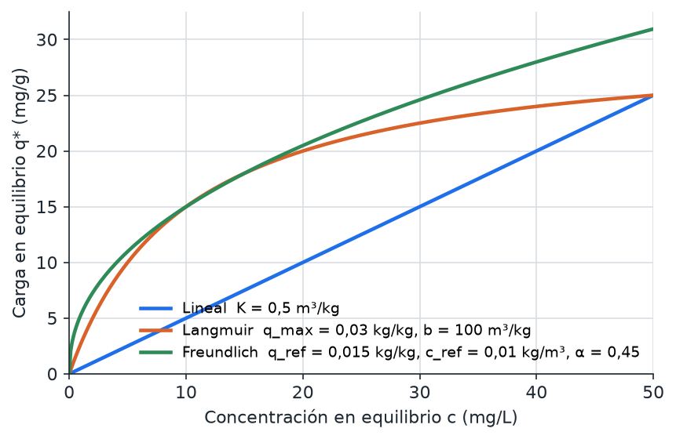
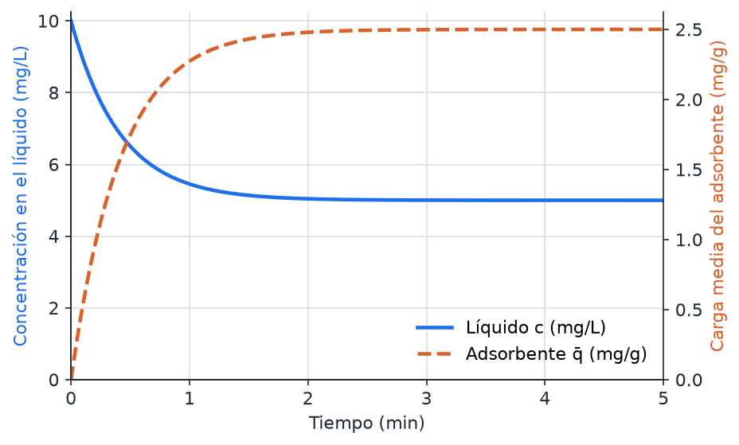
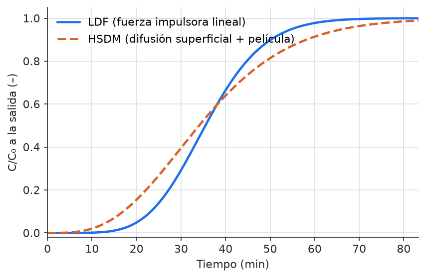
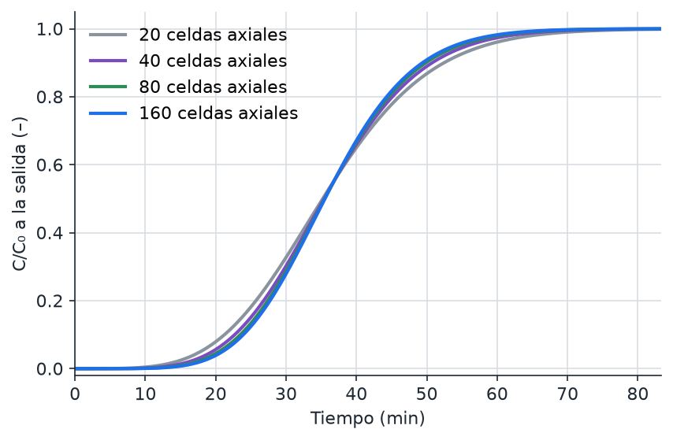
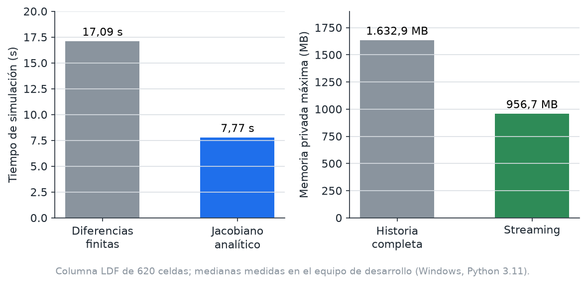

# Galería de figuras

[Inicio](index.md) · [Modelos y ecuaciones](models.md) · [Motores de cálculo](engines.md)

Todas las curvas se obtienen con simulaciones reales de SorbFlow sobre los ejemplos
incluidos en `examples/`. El gráfico de rendimiento solo representa valores medidos y
documentados durante el desarrollo; no ejecuta ningún benchmark. Para regenerarlas
desde la raíz del repositorio:

```powershell
python scripts/make_figures.py                     # escribe en docs/assets/figures/
python scripts/make_figures.py --output otra/carpeta
```

## Isotermas de equilibrio

Isotermas lineal, Langmuir y Freundlich normalizada evaluadas con
`sorbflow.equilibrium.isotherm_from_parameters` y parámetros de ejemplo.



## Cinética batch LDF

`examples/batch_ldf.json`: descenso de la concentración en el líquido y aumento de la
carga media del adsorbente hasta el equilibrio, con balance de masa cerrado.



## Curvas de ruptura LDF y HSDM

`examples/column_ldf.json` y `examples/column_hsdm.json` con 60 celdas axiales (y 12
radiales para HSDM). Ambos ejemplos comparten lecho, operación e isoterma; cambia solo
el modelo cinético, lo que muestra cómo la difusión intrapartícula ensancha la curva.



## Control de la malla

Columna LDF con 20, 40, 80 y 160 celdas axiales. Las curvas convergen al refinar,
que es la comprobación recomendada antes de usar un indicador de diseño.



## Rendimiento medido

Jacobiano analítico frente a diferencias finitas y modo streaming frente a historia
completa en una columna LDF de 620 celdas (equipo de desarrollo, Windows, Python 3.11).
Detalle en [rendimiento](performance.md).


