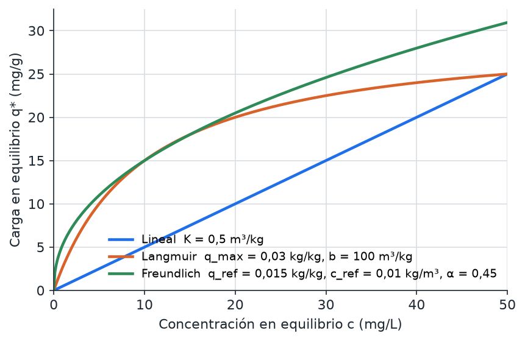
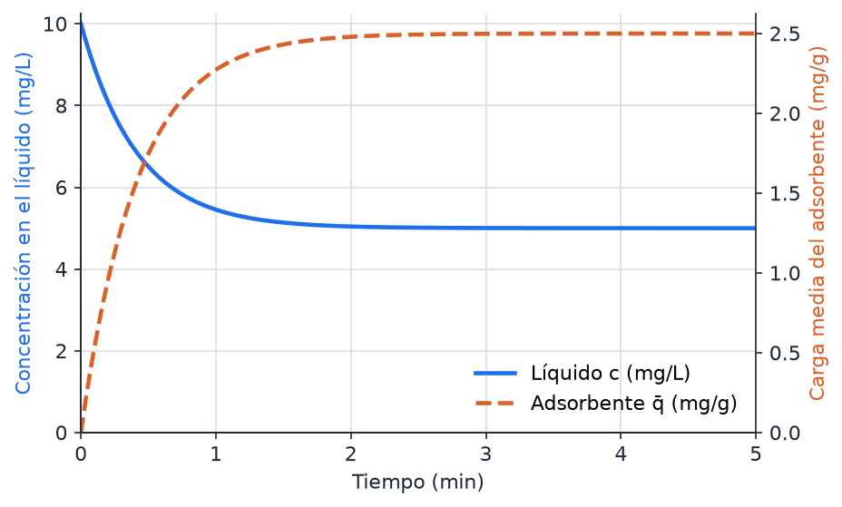
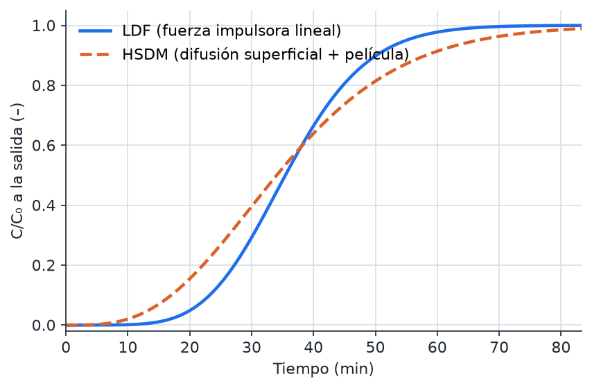

# Modelos y ecuaciones

[Inicio](index.md) · [Motores de cálculo](engines.md) · [Formulación detallada](../MODEL_SPECIFICATION.md)

SorbFlow resuelve balances de masa de un soluto en fase acuosa con un adsorbente
sólido, en un reactor batch o en una columna de lecho fijo. Las ecuaciones son las
de la ingeniería de adsorción clásica; lo propio de SorbFlow es su implementación
conservativa, con unidades SI explícitas y resultados trazables. Esta página resume
el modelo; la [especificación matemática](../MODEL_SPECIFICATION.md) desarrolla
hipótesis y casos límite.

## Símbolos y unidades

| Símbolo | Significado | Unidad SI |
|---|---|---|
| $c$, $c_{in}$, $c_s$ | Concentración en el líquido, en la alimentación y en la superficie de la partícula | kg/m³ |
| $q$, $\bar q$ | Carga local y carga media del adsorbente seco | kg/kg |
| $q^*(c)$ | Carga en equilibrio (isoterma) | kg/kg |
| $\varepsilon$ | Porosidad del lecho | – |
| $\rho_p$, $\rho_b=(1-\varepsilon)\rho_p$ | Densidad seca de partícula y del lecho | kg/m³ |
| $Q$, $A$ | Caudal y área de sección | m³/s, m² |
| $u=Q/A$, $v=u/\varepsilon$ | Velocidad superficial e intersticial | m/s |
| $L$, $z$ | Longitud del lecho y coordenada axial | m |
| $R$, $r$ | Radio de partícula y coordenada radial | m |
| $D_{ax}$, $D_s$ | Dispersión axial y difusividad superficial | m²/s |
| $k_f$, $k_{LDF}$ | Coeficiente de película y constante LDF | m/s, 1/s |
| $a_s=3(1-\varepsilon)/R$ | Área externa de partícula por volumen de lecho | 1/m |
| $V_l$, $m_s$ | Volumen de líquido y masa seca de adsorbente (batch) | m³, kg |

Equivalencias habituales: 1 mg/L = 10⁻³ kg/m³ y 1 mg/g = 10⁻³ kg/kg.

## Isotermas de equilibrio

$$
q^*_{\text{lineal}} = K\,c, \qquad
q^*_{\text{Langmuir}} = \frac{q_{max}\, b\, c}{1 + b\, c}, \qquad
q^*_{\text{Freundlich}} = q_{ref}\left(\frac{c}{c_{ref}}\right)^{\alpha}
$$

La forma normalizada de Freundlich evita constantes con unidades fraccionarias:
$K_F = q_{ref}/c_{ref}^{\alpha}$. Las derivadas $dq^*/dc$ se calculan de forma
analítica; con $\alpha<1$ la pendiente en $c=0$ es infinita y el programa lo informa.

## Cinética

**Fuerza impulsora lineal (LDF)** — una resistencia global de transferencia:

$$
\frac{d\bar q}{dt} = k_{LDF}\,\big[q^*(c) - \bar q\big]
$$

**Difusión superficial homogénea (HSDM)** — difusión radial dentro de una partícula
esférica, acoplada al líquido por una película:

$$
\frac{\partial q}{\partial t} = \frac{D_s}{r^2}\frac{\partial}{\partial r}\left(r^2 \frac{\partial q}{\partial r}\right),
\qquad 0<r<R
$$

$$
\left.\frac{\partial q}{\partial r}\right|_{r=0} = 0, \qquad
\rho_p D_s \left.\frac{\partial q}{\partial r}\right|_{r=R} = k_f\,(c - c_s), \qquad
q(R,t) = q^*(c_s)
$$

$$
\bar q = \frac{3}{R^3}\int_0^R q(r)\, r^2\, dr
$$

Para isotermas lineales y difusión en esfera, la aproximación de Glueckauf
$k_{LDF}\approx 15 D_s/R^2$ relaciona ambos modelos; SorbFlow no la impone.

## Reactor batch

Recipiente cerrado y perfectamente mezclado:

$$
V_l \frac{dc}{dt} = -\,m_s \frac{d\bar q}{dt},
\qquad V_l\,c + m_s\,\bar q = \text{constante}
$$

## Columna de lecho fijo

Balance de advección–dispersión con flujo superficial $J = u\,c - \varepsilon D_{ax}\,\partial c/\partial z$:

$$
\varepsilon \frac{\partial c}{\partial t} + u \frac{\partial c}{\partial z}
= \varepsilon D_{ax} \frac{\partial^2 c}{\partial z^2} - \rho_b \frac{\partial \bar q}{\partial t}
$$

Con LDF, $\partial\bar q/\partial t$ sigue la ecuación LDF en cada posición. Con HSDM,
la fuente usa el mismo flujo de película que entra a la partícula:

$$
\rho_b \frac{\partial \bar q}{\partial t} = a_s\, k_f\, (c - c_s)
$$

Condiciones de frontera de Danckwerts (con $D_{ax}>0$):

$$
u\,c(0,t) - \varepsilon D_{ax}\left.\frac{\partial c}{\partial z}\right|_{z=0} = u\,c_{in},
\qquad
\left.\frac{\partial c}{\partial z}\right|_{z=L} = 0
$$

Con $D_{ax}=0$ la entrada es $c(0,t)=c_{in}$ y la salida es puramente convectiva.

## Magnitudes de diseño

$$
V_b = A L, \quad m_s = \rho_b V_b, \quad
\mathrm{EBCT} = \frac{V_b}{Q}, \quad
\tau_{liq} = \varepsilon\,\mathrm{EBCT}, \quad
BV = \frac{Q\,t}{V_b}
$$

Pérdida de carga de Ergun con velocidad superficial, diámetro de partícula $d_p$,
viscosidad $\mu$ y densidad del líquido $\rho_l$:

$$
\frac{\Delta P}{L} = 150\,\frac{\mu (1-\varepsilon)^2 u}{\varepsilon^3 d_p^2}
+ 1.75\,\frac{\rho_l (1-\varepsilon)\, u\,|u|}{\varepsilon^3 d_p},
\qquad P_{bomba} = \frac{Q\,\Delta P}{\eta}
$$

## Números adimensionales

$$
Pe = \frac{v L}{D_{ax}}, \qquad
\tau_{LDF} = \frac{1}{k_{LDF}}, \qquad
\tau_s = \frac{R^2}{D_s}, \qquad
Bi = \frac{k_f\, R\, c_{0}}{\rho_p D_s\, q^*(c_0)}
$$

$Pe$ mide la importancia de la advección frente a la dispersión axial; $Bi$ (en la
definición usada aquí) compara la transferencia por película con la difusión
intrapartícula. Valores altos de $Bi$ indican control por difusión interna.

## Discretización

- **Eje de la columna**: volúmenes finitos conservativos, convección upwind y
  dispersión centrada; la masa acumulada de entrada y salida se integra como estado.
- **Radio de la partícula (HSDM)**: volúmenes finitos esféricos con pesos exactos de
  cascarón; el centro se trata como volumen finito, sin divisiones por cero.
- **Tiempo**: integradores rígidos BDF o Radau de SciPy con Jacobiano disperso
  (analítico opcional para LDF) y tolerancias separadas para concentración, carga y masa.
- **Control**: cada resultado verifica el balance global de masa y la no negatividad;
  si fallan, se informa un error en lugar de corregir el resultado.
